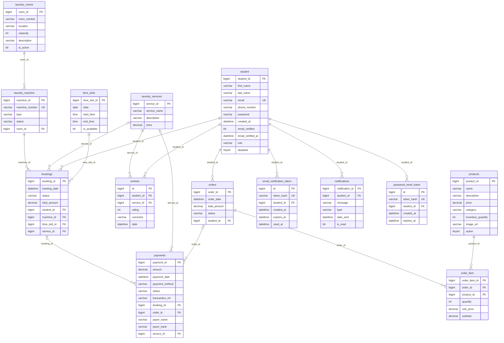
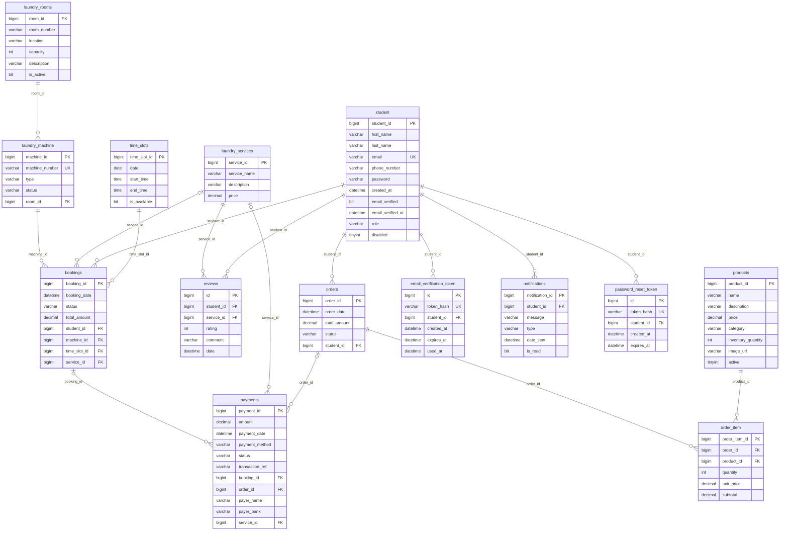

# Database documentation - `laundrybooking_ecommerce`

Residence Laundry Booking and E-commerce System. Source of truth: the JPA entities in `src/main/java/.../domain` on `main` (commit `81f110a`). Hibernate creates the schema with `ddl-auto=update`, so the SQL scripts in `db/migrations/` add the rules that the entities cannot express.

## 1. Summary

- **14 tables** reviewed, all mapped by an entity and used by a repository in the backend. **No table and no column was removed**: every candidate was either used by the code or needs a backend change first (section 8).
- **Added** (all guarded, re-runnable, skipped if existing data would break them): 2 foreign keys, 12 CHECK constraints, 2 unique rules, 5 NOT NULL rules, 4 indexes, and a data clean-up of payment status/method case and empty roles.
- **Optional**: money columns from `DOUBLE` to `DECIMAL(10,2)`.
- **Code change** (`entity-mappings.patch`, 7 entity files, 9 lines): money column definitions, and new students now get role `USER` instead of an empty role.
- Files: `00_audit_checks.sql` (read only), `01_integrity_cleanup.sql`, `02_money_to_decimal.sql` (optional), `03_student_role_not_null.sql` (after the patch), `04_smoke_test.sql` (rolls back), `99_rollback.sql`.

## 2. Entity relationship diagram

The diagram source is `erd.mmd` (Mermaid). Lines read as *parent one-to-many child*; a circle on the parent side means the foreign key is optional. `payments` points at **either** a booking **or** an order (enforced by `chk_payments_target`).

## 3. Tables and columns

Types are what the database holds **after** scripts 01-03 are applied. Hibernate may create `enum(...)` instead of `varchar` for enum columns on newer versions; run `SHOW CREATE TABLE <name>` to see the real definition.

### `student`  (entity `Student`)

Every registered account (residence students and administrators).

| Column | Type | Null | Key | Purpose |
|---|---|---|---|---|
| `student_id` | bigint | no | PK | Auto-increment identifier of the account. |
| `first_name` | varchar(255) | no |  | Given name. |
| `last_name` | varchar(255) | no |  | Surname. |
| `email` | varchar(255) | no | UQ | Login name; unique across accounts. |
| `phone_number` | varchar(255) | no |  | Contact number. |
| `password` | varchar(255) | no |  | BCrypt hash (legacy plain-text rows are upgraded at next login). Never returned by the API. |
| `created_at` | datetime(6) | no |  | When the account was registered. |
| `email_verified` | bit(1) | no |  | True once the emailed verification link has been used. |
| `email_verified_at` | datetime(6) | yes |  | When the email was verified; null if not verified or if the email was changed. |
| `role` | varchar(10) | no |  | USER or ADMIN. Null on legacy rows, which the application treats as USER. |
| `disabled` | tinyint(1) | no |  | True when an administrator deactivated the account; blocks login and invalidates its token. |

### `laundry_rooms`  (entity `LaundryRoom`)

A laundry room in the residence that contains machines.

| Column | Type | Null | Key | Purpose |
|---|---|---|---|---|
| `room_id` | bigint | no | PK | Auto-increment identifier. |
| `room_number` | varchar(50) | no |  | Room label shown to students. |
| `location` | varchar(255) | no |  | Where the room is (building/floor). |
| `capacity` | int | no |  | Number of machines or people the room holds. |
| `description` | varchar(500) | yes |  | Optional free-text description. |
| `is_active` | bit(1) | no |  | Inactive rooms are hidden from booking. |

### `laundry_machine`  (entity `LaundryMachine`)

A washer or dryer that can be booked; belongs to one room.

| Column | Type | Null | Key | Purpose |
|---|---|---|---|---|
| `machine_id` | bigint | no | PK | Auto-increment identifier. |
| `machine_number` | varchar(255) | yes | UQ (added) | Public label of the machine; the code rejects duplicates, the DB now does too (uq_laundry_machine_number). |
| `type` | varchar(255) | yes |  | Machine type, e.g. washer or dryer. |
| `status` | varchar(255) | yes |  | AVAILABLE, IN_USE or OUT_OF_ORDER (MachineStatus). |
| `room_id` | bigint | no | FK -> laundry_rooms.room_id | Room the machine is in. |

### `time_slots`  (entity `TimeSlot`)

A bookable one-hour window on a date.

| Column | Type | Null | Key | Purpose |
|---|---|---|---|---|
| `time_slot_id` | bigint | no | PK | Auto-increment identifier. |
| `date` | date | no |  | Calendar date of the slot. |
| `start_time` | time(6) | no |  | Slot start. |
| `end_time` | time(6) | no |  | Slot end; must be after start_time. |
| `is_available` | bit(1) | no |  | False when an administrator closes the slot. |

### `laundry_services`  (entity `LaundryService`)

Extra paid service that can be attached to a booking (e.g. wash and fold).

| Column | Type | Null | Key | Purpose |
|---|---|---|---|---|
| `service_id` | bigint | no | PK | Auto-increment identifier. |
| `service_name` | varchar(255) | yes |  | Name shown to students. |
| `description` | varchar(255) | yes |  | Short description. |
| `price` | decimal(10,2) | no |  | Price in rand. |

### `bookings`  (entity `Booking`)

A student's reservation of one machine for one time slot, optionally with a service.

| Column | Type | Null | Key | Purpose |
|---|---|---|---|---|
| `booking_id` | bigint | no | PK | Auto-increment identifier. |
| `booking_date` | datetime(6) | no |  | When the booking was made. |
| `status` | varchar(255) | no |  | PENDING, CONFIRMED, CANCELLED or COMPLETED (BookingStatus). |
| `total_amount` | decimal(10,2) | no |  | Amount payable, calculated on the server from the service price. |
| `student_id` | bigint | no | FK -> student.student_id | Student who booked. |
| `machine_id` | bigint | no | FK -> laundry_machine.machine_id | Machine reserved (the room is derived from it). |
| `time_slot_id` | bigint | no | FK -> time_slots.time_slot_id | Slot reserved. |
| `service_id` | bigint | yes | FK -> laundry_services.service_id | Optional service attached to the booking. |

### `products`  (entity `Product`)

Item sold in the e-commerce shop.

| Column | Type | Null | Key | Purpose |
|---|---|---|---|---|
| `product_id` | bigint | no | PK | Auto-increment identifier. |
| `name` | varchar(255) | yes |  | Product name. |
| `description` | varchar(255) | yes |  | Short description. |
| `price` | decimal(10,2) | no |  | Unit price in rand. |
| `category` | varchar(255) | yes |  | Shop category label. |
| `inventory_quantity` | int | no |  | Units in stock. |
| `image_url` | varchar(255) | yes |  | Path of the uploaded picture. |
| `active` | tinyint(1) | no |  | False hides the product from the shop without deleting it. |

### `orders`  (entity `Order`)

A shop order placed by a student.

| Column | Type | Null | Key | Purpose |
|---|---|---|---|---|
| `order_id` | bigint | no | PK | Auto-increment identifier. |
| `order_date` | datetime(6) | no |  | When the order was placed. |
| `total_amount` | decimal(10,2) | no |  | Order total in rand. |
| `status` | varchar(20) | no |  | PENDING, PAID, IN_PROGRESS, COMPLETED or CANCELLED (OrderStatus). |
| `student_id` | bigint | no | FK -> student.student_id | Student who ordered. |

### `order_item`  (entity `OrderItem`)

One product line on an order.

| Column | Type | Null | Key | Purpose |
|---|---|---|---|---|
| `order_item_id` | bigint | no | PK | Auto-increment identifier. |
| `order_id` | bigint | no | FK -> orders.order_id | Order this line belongs to. |
| `product_id` | bigint | no | FK -> products.product_id | Product bought. |
| `quantity` | int | no |  | Units bought. |
| `unit_price` | decimal(10,2) | no |  | Price per unit at purchase time (snapshot). |
| `subtotal` | decimal(10,2) | no |  | quantity x unit_price, stored so reports match what was charged. |

### `payments`  (entity `Payment`)

A payment attempt for either a booking or an order.

| Column | Type | Null | Key | Purpose |
|---|---|---|---|---|
| `payment_id` | bigint | no | PK | Auto-increment identifier. |
| `amount` | decimal(10,2) | no |  | Amount paid in rand. |
| `payment_date` | datetime(6) | yes |  | When the payment was recorded. |
| `payment_method` | varchar(255) | no |  | CARD or EFT. |
| `status` | varchar(255) | no |  | PENDING, COMPLETED or FAILED. |
| `transaction_ref` | varchar(255) | yes |  | EFT reference the student quotes at the bank (not unique: a retry reuses it). |
| `booking_id` | bigint | yes | FK -> bookings.booking_id | Booking paid for (exactly one of booking_id/order_id is set). |
| `order_id` | bigint | yes | FK -> orders.order_id | Order paid for (exactly one of booking_id/order_id is set). |
| `payer_name` | varchar(255) | yes |  | Name on the EFT, for admin verification. |
| `payer_bank` | varchar(255) | yes |  | Bank used for the EFT, for admin verification. |
| `service_id` | bigint | yes | FK -> laundry_services.service_id | REDUNDANT: the service is already reachable through the booking. |

### `reviews`  (entity `Review`)

A student's rating of a laundry service.

| Column | Type | Null | Key | Purpose |
|---|---|---|---|---|
| `id` | bigint | no | PK | Auto-increment identifier. |
| `student_id` | bigint | no | FK -> student.student_id | Reviewer. |
| `service_id` | bigint | no | FK -> laundry_services.service_id | Service reviewed. |
| `rating` | int | no |  | 1 to 5. |
| `comment` | varchar(255) | yes |  | Optional text. |
| `date` | datetime(6) | yes |  | When the review was written. |

### `notifications`  (entity `Notification`)

In-app message to a student (booking confirmed, payment received, ...).

| Column | Type | Null | Key | Purpose |
|---|---|---|---|---|
| `notification_id` | bigint | no | PK | Auto-increment identifier. |
| `student_id` | bigint | no | FK -> student.student_id | Recipient. |
| `message` | varchar(255) | no |  | Text shown to the student. |
| `type` | varchar(255) | no |  | BOOKING_CONFIRMATION, BOOKING_CANCELLED, ORDER_COMPLETE or PAYMENT_CONFIRMATION. |
| `date_sent` | datetime(6) | no |  | When it was created. |
| `is_read` | bit(1) | no |  | Read flag. |

### `email_verification_token`  (entity `EmailVerificationToken`)

Single-use email verification links (only a SHA-256 hash is stored).

| Column | Type | Null | Key | Purpose |
|---|---|---|---|---|
| `id` | bigint | no | PK | Auto-increment identifier. |
| `token_hash` | varchar(64) | no | UQ | SHA-256 of the emailed token. |
| `student_id` | bigint | no | FK -> student.student_id | Account being verified; rows are removed with the student (ON DELETE CASCADE). |
| `created_at` | datetime(6) | no |  | Issue time. |
| `expires_at` | datetime(6) | no |  | Expiry time. |
| `used_at` | datetime(6) | yes |  | Set when the link is used; makes it single-use. |

### `password_reset_token`  (entity `PasswordResetToken`)

Password-reset links (hash only).

| Column | Type | Null | Key | Purpose |
|---|---|---|---|---|
| `id` | bigint | no | PK | Auto-increment identifier. |
| `token_hash` | varchar(64) | no | UQ | SHA-256 of the emailed token. |
| `student_id` | bigint | no | FK -> student.student_id | Account being reset (ON DELETE CASCADE). |
| `created_at` | datetime(6) | no |  | Issue time. |
| `expires_at` | datetime(6) | no |  | Expiry time. |

## 4. Primary and foreign keys

Every table has a single-column auto-increment primary key. Foreign keys, with their delete behaviour (`RESTRICT` = the parent cannot be deleted while children exist):

| Child column | Parent | On delete | Source |
|---|---|---|---|
| `laundry_machine.room_id` | `laundry_rooms.room_id` | RESTRICT | entity |
| `bookings.student_id` | `student.student_id` | RESTRICT | entity |
| `bookings.machine_id` | `laundry_machine.machine_id` | RESTRICT | entity |
| `bookings.time_slot_id` | `time_slots.time_slot_id` | RESTRICT | entity |
| `bookings.service_id` | `laundry_services.service_id` | RESTRICT | entity |
| `orders.student_id` | `student.student_id` | RESTRICT | entity |
| `order_item.order_id` | `orders.order_id` | RESTRICT | entity |
| `order_item.product_id` | `products.product_id` | RESTRICT | entity |
| `payments.booking_id` | `bookings.booking_id` | RESTRICT | **added by 01** (was a plain number) |
| `payments.order_id` | `orders.order_id` | RESTRICT | **added by 01** (was a plain number) |
| `payments.service_id` | `laundry_services.service_id` | RESTRICT | entity |
| `reviews.student_id` | `student.student_id` | RESTRICT | entity |
| `reviews.service_id` | `laundry_services.service_id` | RESTRICT | entity |
| `notifications.student_id` | `student.student_id` | RESTRICT | entity |
| `email_verification_token.student_id` | `student.student_id` | CASCADE | entity |
| `password_reset_token.student_id` | `student.student_id` | CASCADE | entity |

## 5. Relationships

| Parent | Child | Meaning |
|---|---|---|
| `student` | `bookings` | a student makes many bookings |
| `student` | `orders` | a student places many orders |
| `student` | `reviews` | a student writes many reviews |
| `student` | `notifications` | a student receives many notifications |
| `student` | `email_verification_token / password_reset_token` | one-time links; deleted with the student |
| `laundry_rooms` | `laundry_machine` | a room holds many machines |
| `laundry_machine` | `bookings` | a machine is booked many times |
| `time_slots` | `bookings` | a slot can hold bookings on different machines |
| `laundry_services` | `bookings` | optional extra service on a booking |
| `laundry_services` | `reviews` | services are reviewed |
| `orders` | `order_item` | an order has many lines |
| `products` | `order_item` | a product appears on many lines |
| `bookings` | `payments` | a booking can have several attempts (e.g. a failed then a successful one) |
| `orders` | `payments` | same for orders |
| `laundry_services` | `payments` | redundant, see section 8 |

There are no many-to-many tables. `order_item` is the line table between `orders` and `products`.

## 6. Constraints added by `01_integrity_cleanup.sql`

| Name | Rule | Why |
|---|---|---|
| fk_payments_booking / fk_payments_order | payments.booking_id / order_id must exist in bookings / orders | they were plain numbers, so a payment could point at a deleted booking |
| chk_payments_target | exactly one of booking_id, order_id is set | PaymentServiceImpl already rejects both or neither |
| chk_payments_status | PENDING, COMPLETED or FAILED | the only values the service writes |
| chk_payments_method | CARD or EFT | the only methods the service accepts |
| chk_payments_amount, chk_bookings_total, chk_orders_total, chk_services_price | amount >= 0 | money cannot be negative |
| chk_order_item_values | quantity > 0, prices >= 0 |  |
| chk_products_values | price >= 0, stock >= 0 | stock cannot go negative |
| chk_rooms_capacity | capacity >= 0 |  |
| chk_reviews_rating | 1 to 5 | ReviewFactory enforces it |
| chk_time_slots_range | end_time > start_time | TimeSlotFactory enforces it |
| uq_laundry_machine_number | machine number unique | the service checks it; the database now stops two requests racing past the check |
| uq_time_slots_window | unique (date, start_time, end_time) | two identical slots would defeat the double-booking check |
| NOT NULL | payments.status, payments.payment_method, time_slots.date / start_time / end_time; student.role (script 03) | every code path that creates these rows already fills them |
| indexes | bookings(machine_id, time_slot_id), time_slots(date), notifications(student_id, is_read), payments(status) | match the repository queries |

## 7. Removed or modified

| Object | Change | Reason |
|---|---|---|
| tables | **none removed** | all 14 are mapped and used |
| columns | **none removed** | see section 8 for each candidate |
| payments.status, payments.payment_method | values upper-cased and trimmed; made NOT NULL | the service compares them case-insensitively, so older rows may be `Pending` or `eft` |
| student.role | empty roles set to `USER`; NOT NULL after the patch | `Student.getRole()` already treated empty as USER, but new registrations were saved with an empty role |
| time_slots.date / start_time / end_time | made NOT NULL | `TimeSlotFactory` rejects nulls |
| money columns (7) | optional `DOUBLE` -> `DECIMAL(10,2)` | floating point cannot hold 0.10 exactly; reports and EFT matching need exact cents |
| payments.booking_id, order_id | foreign keys added | orphan protection |

## 8. Reviewed and deliberately NOT changed

| Finding | Evidence | Decision |
|---|---|---|
| `payments.service_id` is redundant: the service is reachable through the booking | Only written when a client sends `serviceId` to `/payment/create`; the frontend never does. Read only by `PaymentRepository.findByServiceId` and copied in `PaymentServiceImpl`. | **Keep for now.** Dropping it needs edits to `Payment`, `PaymentFactory`, `PaymentService(Impl)`, `PaymentController` (the `serviceId` parameter), `PaymentRepository`, and tests. Recommended as a follow-up change together with the backend team. |
| `student.email_verified` duplicates `email_verified_at IS NOT NULL` | Both are read (`JwtAuthFilter`, `StudentServiceImpl`) | Keep; the boolean is the fast flag, the timestamp is the audit. |
| `order_item.subtotal` is derivable | Used by `AdminReportService` and the order pages | Keep as a price snapshot; section I of the audit script flags rows where it disagrees with quantity x unit price. |
| `email_verification_token.used_at` | Written by `markUsed` in `EmailVerificationServiceImpl` | Keep; it makes the link single-use. |
| Unique `(student_id, service_id)` on reviews | `ReviewServiceImpl` has no one-review-per-service rule | Not added: it would change behaviour. Team decision. |
| Unique `payments.transaction_ref` | The EFT reference is generated per booking/order, so a retry after a failure reuses it | Not added; it would block retries. |
| Mixed table naming (`student`, `laundry_machine`, `order_item`, `*_token` singular; the rest plural) | Names come from `@Table` | Not renamed. Renaming an entity table makes Hibernate create a new empty table next to the old one (`ddl-auto=update`), and every teammate's local database would diverge. Do it once, together, with `RENAME TABLE` plus the matching `@Table`. |
| `Order.studentId` is a `Student` object, not an id | Java field name; the column `student_id` is fine | Not renamed: the JSON property `studentId` is used by the frontend. |
| `LaundryRoom.machines` uses `CascadeType.ALL` + `orphanRemoval` | `deleteRoom` calls `deleteById` | Not changed. Machines with bookings are protected by the foreign key; empty machines are deleted with their room. Remove `REMOVE` from the cascade if that is unwanted. |
| Money as `double` in Java | Seven entity fields | The column type is fixed by script 02 without changing the services. Moving to `BigDecimal` is a larger refactor. |

## 9. Design improvements and recommendations

1. **One shared schema.** Every developer's database is built by `ddl-auto=update`, which never drops or alters columns, so local databases drift. Use these scripts as the shared baseline, and consider Flyway later (it needs a `pom.xml` change, so it was not done here).
2. **Run `00_audit_checks.sql` on each real database.** Sections A and B list tables and columns left behind by older versions of the entities. That is the only way to find objects that exist in MySQL but not in the code; none could be inspected from here.
3. **Payments have one owner.** A payment now belongs to exactly one booking or order, and neither can be deleted while payments exist. A deleted-while-paid request returns HTTP 409 through `GlobalExceptionHandler`.
4. **Soft deletes.** `student.disabled` and `products.active` already hide records instead of deleting them; keep using them rather than hard deletes.

## 10. Backend compatibility

- No table or column the code reads was removed or renamed, so repositories, JPQL queries (`IOrderRepository`, `IOrderItemRepository`, `ILaundryMachineRepository`) and DTOs are unaffected. There are no native queries.
- `ddl-auto=update` does not remove foreign keys, checks, unique rules or indexes, and does not shrink columns, so Hibernate will not undo or recreate anything on startup.
- The money change reads and writes through `double`; MySQL rounds to 2 decimals on write.
- Behaviour changes to expect: duplicate machine numbers and time-slot windows now fail at the database (409), and deleting a booking or order that has payments is refused.

## 11. Testing and verification

**Run:** the scripts were executed on MariaDB 10.11 against a schema built from the entities, with seed data and deliberately bad data.

| Test | Result |
|---|---|
| Audit queries run without error on a clean database; sections A-D return nothing | pass |
| Dirty data (an orphan payment, a duplicate slot, a rating of 9): audit finds all three; cleanup skips exactly those three steps and applies the rest | pass |
| Clean data: every step applies; payment `Pending`/`card` become `PENDING`/`CARD`; empty roles become `USER` | pass |
| Second run does nothing (all 25 steps report already done) | pass |
| 9 invalid writes (orphan payment, two targets, no target, bad method, rating 0, duplicate slot, duplicate machine, deleting a paid booking, negative stock) are all rejected | pass |
| Normal operations: insert payment/booking/student, update payment status, delete a student | pass |
| `04_smoke_test.sql`: booking, order, payment (EFT then verified, and card), notification and user deactivation work and retrieve correctly; rolls back, 0 rows left | pass |
| 02 converts 7 money columns; values such as 19.99 and 50.50 survive; re-run is a no-op | pass |
| `99_rollback.sql` removes every constraint, index and type change | pass |
| `03`: inserting an empty role is rejected afterwards | pass |

**Not run, and why:**

- The Spring Boot application, `mvnw clean test` and API calls: Maven Central is not reachable from the build environment. The entity patch is annotation-only and applies cleanly to `main`, but it has not been compiled. Run `.\mvnw clean test` and exercise the booking, order, payment and registration endpoints before merging.
- MySQL 8 itself (only MariaDB was available). The syntax used is common to both; `CHECK` needs MySQL 8.0.16 or newer.
- Your real database. Run `00_audit_checks.sql` there first.

## 12. How to apply

1. Back up: `mysqldump -u root -p laundrybooking_ecommerce > backup.sql`.
2. Run `00_audit_checks.sql`; read sections A-J.
3. Run `01_integrity_cleanup.sql`. Any step it reports as SKIPPED has bad data; fix it and run the script again.
4. Apply `entity-mappings.patch` (`git apply --ignore-whitespace entity-mappings.patch`), build, and start the backend.
5. Run `03_student_role_not_null.sql`, and optionally `02_money_to_decimal.sql`.
6. Run `04_smoke_test.sql`, then `.\mvnw clean test`.
7. On a brand-new database: start the backend once so Hibernate creates the tables, then run 01, 02 and 03.
